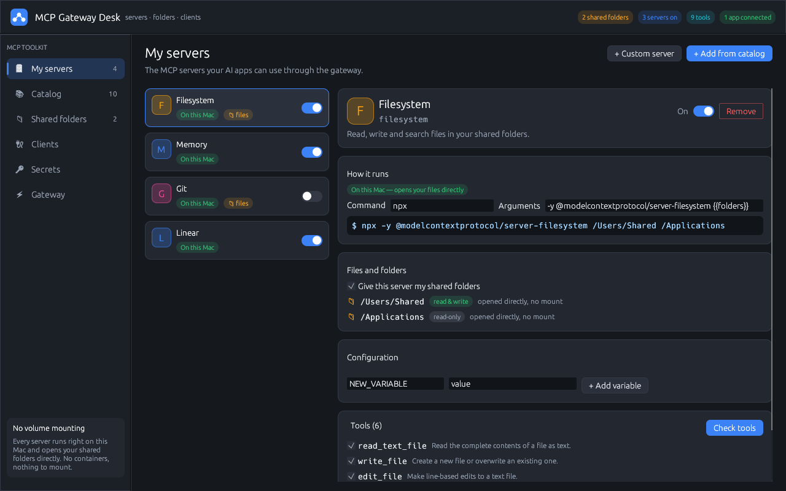
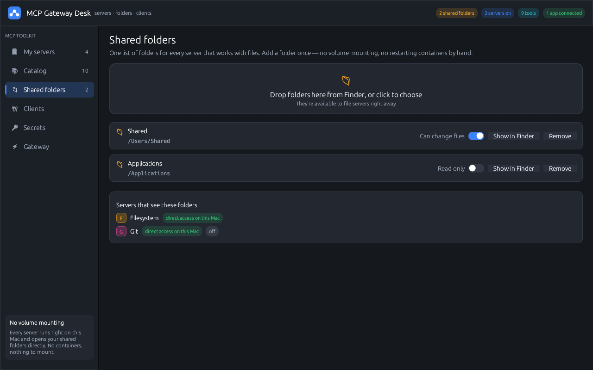
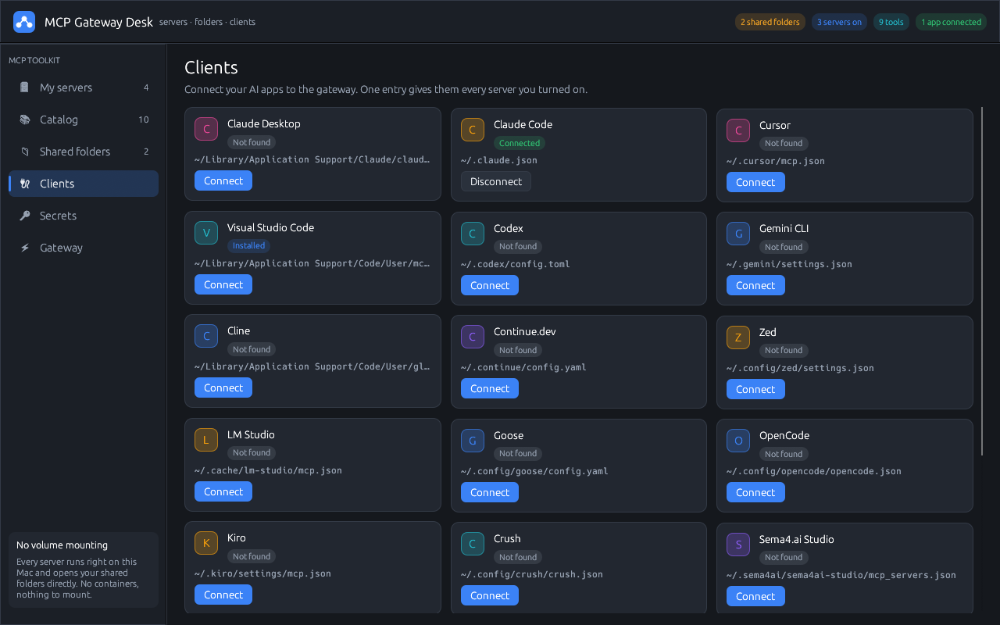
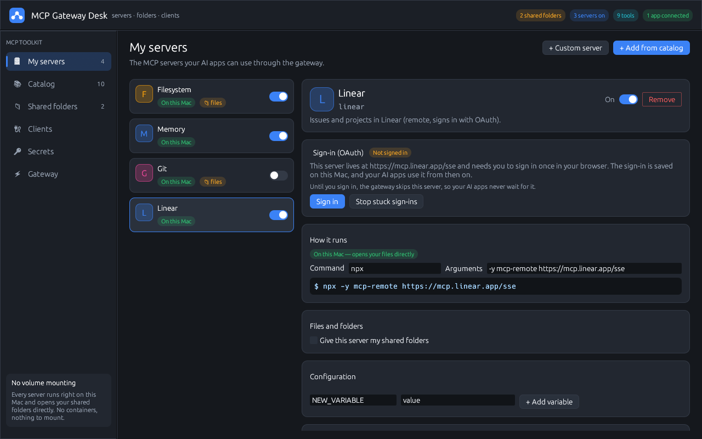

# MCP Gateway Desk

A small macOS app for managing your [MCP](https://modelcontextprotocol.io) servers and connecting them to your AI apps — Claude Code, Claude Desktop, Cursor, VS Code, Codex, Gemini CLI, Zed and more — through **one** gateway entry.

It works like an MCP toolkit, with one big difference: **every server runs right on your Mac, not in a container.** Servers that work with files open your folders directly, so there's no volume mounting and no restarting containers to give a server access to a folder. You keep one list of **shared folders**, and every file server can use it straight away.



## Features

- **My servers** — switch servers on and off, edit their command and settings, and see each server's tools ("Check tools"). You can also turn off single tools.
- **Catalog** — servers that run on your Mac through `npx` / `uvx`, plus hosted (remote) servers through the `mcp-remote` bridge. You can also add any command as a custom server.
- **Shared folders** — drop folders in from Finder. File servers get them as arguments (`{{folders}}`) and as MCP *roots*. Each folder can be read-only.
- **Clients** — connect or disconnect AI apps with one click. Their settings files are edited for you, and a copy of each file is kept before the first change.
- **Sign-in (OAuth)** — remote servers that need a login get a **Sign in** button with an *Open sign-in page* link. The gateway skips servers that aren't signed in, so your AI app never waits for a login.
- **Secrets** — API keys are kept in the macOS Keychain and passed to servers when they start.
- **Menu-bar icon** — keeps running with the window closed: see status, switch servers on/off, add folders, open the window, start at login.
- **Live changes** — switching a server on or off, or changing folders, reaches your AI apps without restarting them. The gateway watches its settings and sends `notifications/tools/list_changed`.

| Shared folders | Clients | Sign-in |
|---|---|---|
|  |  |  |

## Install

### Homebrew

```sh
brew tap winter-wub/mcp-gateway-desk https://github.com/winter-wub/mcp-gateway-desk
brew install --cask winter-wub/mcp-gateway-desk/mcp-gateway-desk
```

This installs **MCP Gateway Desk.app** into Applications and the `mcp-gateway-desk` command. Update with `brew upgrade --cask mcp-gateway-desk`.

### Download (.dmg)

Get `MCP-Gateway-Desk-<version>.dmg` from [Releases](https://github.com/winter-wub/mcp-gateway-desk/releases), open it and drag the app to Applications.

The app isn't notarized by Apple yet, so the first time, **right-click the app → Open → Open**. Or run:

```sh
xattr -dr com.apple.quarantine "/Applications/MCP Gateway Desk.app"
```

(The Homebrew install does this for you.)

### Requirements

- macOS 11 or later (Apple Silicon or Intel)
- [Node.js](https://nodejs.org) for `npx` servers, and [uv](https://docs.astral.sh/uv/) for `uvx` servers — only for the servers that use them. Docker isn't needed.

## Getting started

1. **Shared folders** → drop in the folders your AI may work with.
2. **Catalog** → add *Filesystem* (and anything else you like), then press **Check tools** to see it working.
3. **Clients** → press **Connect** next to your AI app, then restart that app once.

Your AI app now starts `mcp-gateway-desk gateway run` and gets the tools of every server you turned on.

For an app that isn't listed, add this to its MCP settings:

```json
{
  "mcpServers": {
    "MCP_DESK": {
      "command": "/Applications/MCP Gateway Desk.app/Contents/MacOS/mcp-gateway-desk",
      "args": ["gateway", "run"]
    }
  }
}
```

## How it works

- `mcp-gateway-desk` — the window.
- `mcp-gateway-desk gateway run` — the stdio MCP gateway your AI apps start. It answers at once and starts all servers side by side. Tools that are ready within 10 s are listed, and slower servers are added (with a *tools changed* notice) as soon as they're ready. Tool calls are passed to the right server, and calls run side by side.
- `mcp-gateway-desk tray` — the menu-bar icon.

Each server gets only its own settings plus `PATH` (and the few variables `npx`/`uvx` need), not your whole environment. When the gateway stops, every server it started stops with it.

Settings live in `~/.mcp-gateway-desk/` (`state.json`, `gateway.log`). Secrets are in the Keychain under `mcp-gateway-desk`. Remote sign-ins are kept by `mcp-remote` in `~/.mcp-auth/`.

## Build from source

```sh
cargo build --release
./target/release/mcp-gateway-desk
```

Make the app and .dmg locally:

```sh
./scripts/bundle.sh 0.1.0              # this Mac's architecture
./scripts/bundle.sh --universal 0.1.0  # Apple Silicon + Intel (needs both Rust targets)
```

Set `SIGN_IDENTITY="Developer ID Application: …"` to sign with your certificate instead of ad hoc.

## Releasing

1. Bump `version` in `Cargo.toml` and commit.
2. Tag and push: `git tag v0.2.0 && git push origin v0.2.0`.

The **Release** workflow tests, builds the universal app and `.dmg`, publishes the GitHub release, and updates `Casks/mcp-gateway-desk.rb` with the new version and checksum.

## ภาษาไทย (สรุปสั้น ๆ)

MCP Gateway Desk เป็นแอปบน Mac สำหรับจัดการ MCP server และเชื่อมกับแอป AI อย่าง Claude Code, Cursor หรือ VS Code ผ่าน gateway ตัวเดียว ทุก server รันบนเครื่องโดยตรง ไม่ต้องใช้ container จึงไม่ต้อง mount volume ให้ยุ่งยาก แค่ลากโฟลเดอร์มาใส่ในหน้า **Shared folders** แล้ว server ที่ทำงานกับไฟล์ก็ใช้ได้ทันที

ติดตั้งผ่าน Homebrew:

```sh
brew tap winter-wub/mcp-gateway-desk https://github.com/winter-wub/mcp-gateway-desk
brew install --cask winter-wub/mcp-gateway-desk/mcp-gateway-desk
```

หรือดาวน์โหลดไฟล์ .dmg จากหน้า Releases เปิดครั้งแรกให้คลิกขวาที่แอป แล้วเลือก Open

## License

[MIT](LICENSE)

This is an independent project. It isn't affiliated with or endorsed by Docker, Inc. or Anthropic.
